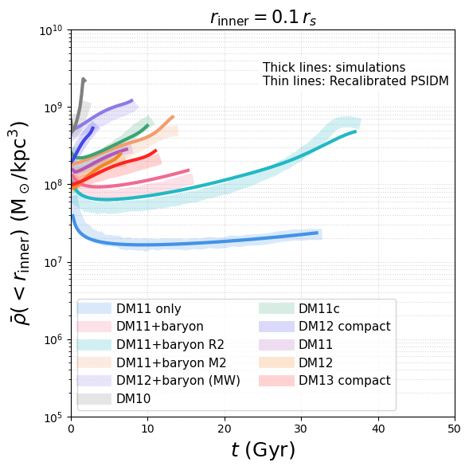
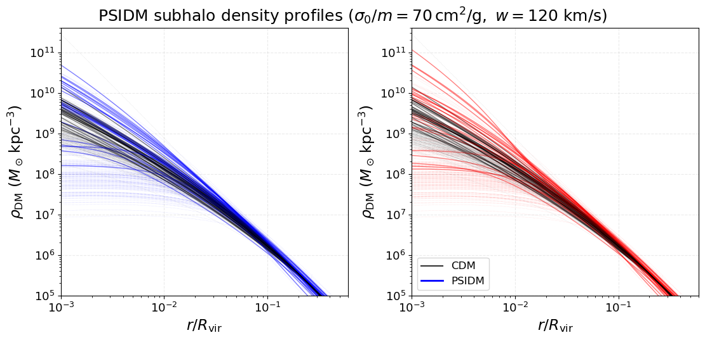

# Recalibrated BaryonicPSIDM

This repository provides a recalibrated parametric model for
self-interacting dark matter (SIDM) halo density profiles in the
presence of baryons.

The implementation builds on the original PSIDM framework and includes
examples comparing the model predictions with controlled simulations
and illustrating subhalo density profiles in a galaxy cluster.

## File structure

### Model implementations

- `lib/parametricCoredDZ.py`: recalibrated BaryonicPSIDM model.
- `lib/parametricCoredDZ_legacy.py`: original PSIDM model.
- `lib/vd_sigma.py`: velocity-dispersion calculations.

### Examples and data

- `example/plot_simulation_vs_parametric.py`: comparison of density
  profiles from controlled simulations and parametric models.
- `example/plot_subhalo_PSIDM.py`: comparison of CDM subhalo density
  profiles with predictions from the original PSIDM and recalibrated
  BaryonicPSIDM models.
- `example/controlled_simulation_profiles/`: density-profile data from
  controlled simulations.
- `example/PM_data_main0_w_120_sigma0_70.csv`: parameters for a selected
  subhalo sample in the most massive cluster in TNG300-1 at z = 0.44.

## Requirements

The code requires Python 3.7 or later, with:

- NumPy
- SciPy
- Matplotlib
- pandas

For example, create a dedicated conda environment:

```bash
conda create -n baryonic_psidm python=3.11 numpy scipy matplotlib pandas
conda activate baryonic_psidm
```

## Usage

Run the examples from the `example` directory:

```bash
cd example

# Compare controlled simulations with parametric models
python plot_simulation_vs_parametric.py

# Compare CDM, original PSIDM, and recalibrated BaryonicPSIDM profiles
python plot_subhalo_PSIDM.py
```

On a server without a graphical display, use:

```bash
MPLBACKEND=Agg python plot_simulation_vs_parametric.py
MPLBACKEND=Agg python plot_subhalo_PSIDM.py
```

Output figures are saved in the working directory.

## Example results

### Controlled simulations and parametric models




Comparison of density profiles from controlled simulations with predictions from the recalibrated BaryonicPSIDM models.

### Subhalo population



Density profiles for a selected subhalo sample in the most massive TNG300-1 cluster at z = 0.44. CDM profiles are compared with predictions
from the original PSIDM and recalibrated BaryonicPSIDM models. Solid curves highlight subhalos satisfying $0.5'' < \theta_{\mathrm{E,eff}} < 3''$.


## Units

Unless otherwise stated, model inputs use:

| Quantity | Unit |
|---|---|
| Mass | solar masses |
| Radius | physical kpc |
| Density | solar masses per cubic kpc |
| Velocity | km/s |
| Evolution parameter `tr` | dimensionless |

In the supplied subhalo parameter table, `Mh` and `Mb` are stored in
units of 10^10 solar masses. The example script converts these values
before evaluating the density models.

## References and acknowledgements

This implementation builds on the original PSIDM framework.
Please cite the associated recalibration paper, the original model
papers, and the relevant simulation references when using this repository.

Full bibliographic information will be added with the accompanying
publication.
